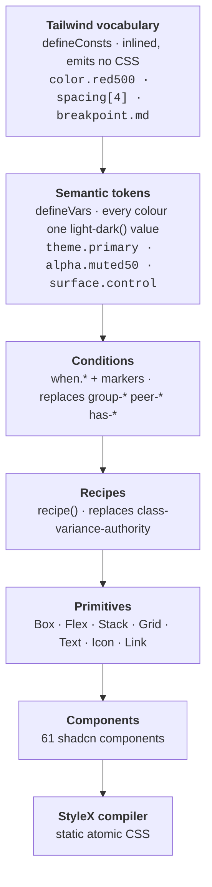

# shadcn/ui on StyleX

A TanStack Start monorepo with the shadcn/ui component set rebuilt on
[StyleX](https://stylexjs.com), and a design system layered on top of it that
keeps Tailwind's vocabulary and Panda's ideas about tokens and recipes.

> **StyleX is the compiler, Panda is the inspiration for the API, and Tailwind is
> the vocabulary.**

There is no Tailwind, no `cn`, no `class-variance-authority`, and no `dark:`
variant anywhere in the codebase. Every style is compiled to atomic CSS at build
time.



## Documentation

Start at [`docs/README.md`](docs/README.md). The four documents there cover the
whole system:

| Document                                                  | What it answers                                                |
| --------------------------------------------------------- | -------------------------------------------------------------- |
| [architecture.md](docs/architecture.md)                   | How it is layered, and why each decision went that way         |
| [porting-from-tailwind.md](docs/porting-from-tailwind.md) | The mental shift, the utility-by-utility mapping, the pitfalls |
| [catalogue.md](docs/catalogue.md)                         | What already exists, so you do not rebuild it                  |
| [workflows.md](docs/workflows.md)                         | Adding a component, removing one, verifying a port             |

Agents get the same rules in condensed form from the skill at
[`.agents/skills/stylex-design-system/`](.agents/skills/stylex-design-system/SKILL.md),
symlinked into `.claude/skills/`.

## Layout

```
apps/web                  the demo page
apps/blocks               shadcn's preview blocks, whole and card by card
apps/examples             every component in the variants the registry shows
packages/shell            the sidebar, search and index pages both apps share
packages/vite-config      the one Vite + StyleX config all three apps use
packages/ui/src
├── tokens/               Layer 1 — Tailwind scales as `defineConsts`
├── theme/                Layer 2–3 — semantic tokens, themes, markers, context
├── recipes/              Layer 4 — variant tables, shared component chrome
├── primitives/           Layer 5 — Box, Flex, Stack, Grid, Text, Icon, Link
├── components/           Layer 6 — the shadcn components
└── styles/globals.css    the only hand-written CSS: a structural reset
```

Dependency versions used by more than one workspace are pinned once, in the Bun
catalog in the root `package.json`, and referenced as `"catalog:"`. Anything a
single workspace uses is versioned in that workspace alone.

## Using components

```tsx
import { Button } from "@workspace/ui/components/button"
import { Stack, Text } from "@workspace/ui/primitives"
```

Components take an `sx` prop instead of `className`, applied last so a caller can
always override:

```tsx
<Button variant="outline" size="sm" sx={styles.pushEnd}>
  Save
</Button>
```

Plain elements take `sx` too. There it is StyleX's own JSX shorthand, which the
compiler turns into `{...stylex.props(...)}`. An array composes several styles,
and later entries win:

```tsx
<div sx={[styles.row, isActive && styles.active, sx]} />
```

## Theming

Every colour token is one `light-dark(<light>, <dark>)` value. `ThemeProvider`
sets `color-scheme` on `<html>` for the three modes: `light dark` for system, which
follows the OS with no JavaScript, so the first paint is already correct, and
`light` or `dark` to pin one. It needs Chrome 123, Safari 17.5 or Firefox 120.

```tsx
import { ThemeProvider, useTheme } from "@workspace/ui/theme/theme-provider"
```

## Scripts

This baseline is built and measured from the lab's root (`vp run build:stylex`, then the
harness); see the root README. On its own:

```bash
bun run --cwd apps/web dev     # web on :3000; blocks on :3001, examples on :3002 likewise
bun run check:stylex           # the StyleX static checks
```

## Blocks and examples

`apps/blocks` renders shadcn's blocks: a dashboard, 16 sidebars, five login and
five signup pages — each in a resizable preview frame, and full screen on its own
`/view/<name>` route — plus the two preview canvases, whole and card by card. `apps/examples` renders all 59 component examples from the shadcn
registry; the four sidebar examples, which bring their own sidebar, are framed
the same way on `/view/<name>`. Both use `packages/shell` for a sidebar listing every page, ⌘K search,
a `/search` page and the theme toggle. A page is a file: drop a card or an
example into the app's source folder and the registry picks it up.

They are also the widest test this design system has. Each has a Tailwind twin in
`../tailwind` on ports 3102 and 3103, and the two are compared page
by page — see [docs/workflows.md](docs/workflows.md#blocks-and-examples).

## Adding a component

`bunx shadcn add` no longer applies, because its output is Tailwind. Take the
upstream component as a reference for structure and behaviour, then write the
styles against this design system. The process is in
[docs/workflows.md](docs/workflows.md) and the mapping table in
[docs/porting-from-tailwind.md](docs/porting-from-tailwind.md) is most of the
work.
