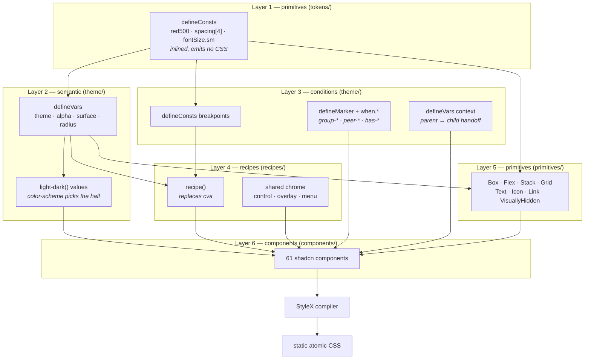
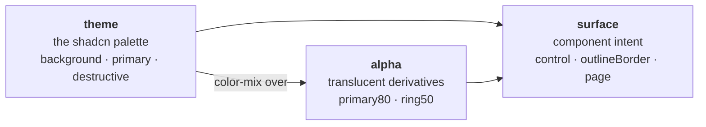
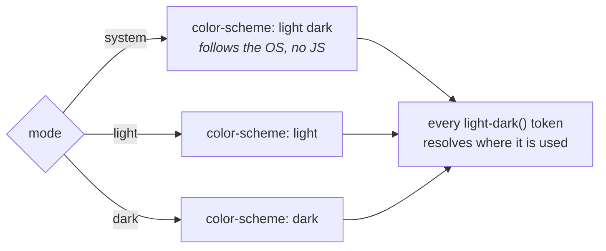
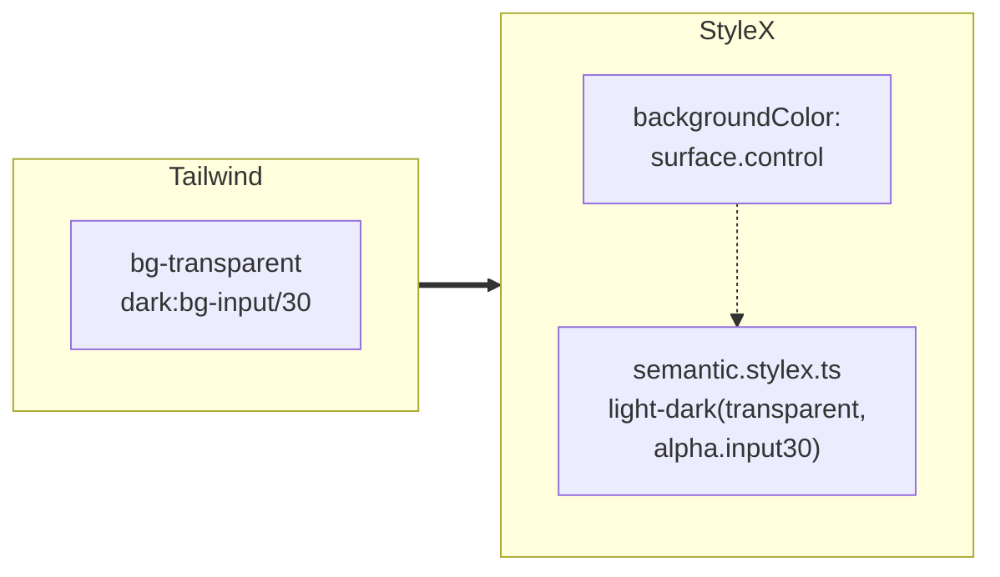
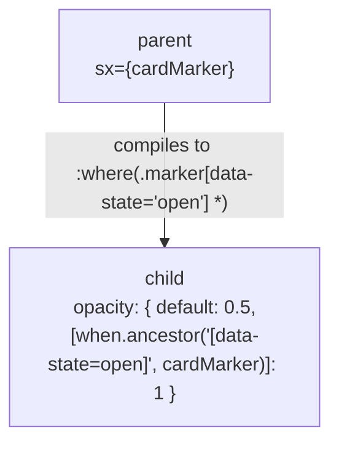
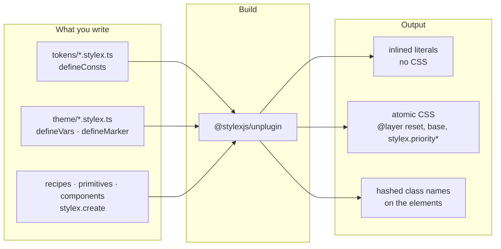

# Architecture

## The shape of it



## Why each layer is the way it is

### Primitives are constants, not variables

The obvious move is `defineVars` for everything. It is the wrong one.

`defineVars` emits a real CSS custom property for every token, whether or not
anything uses it. The full Tailwind palette is 290 colours; as variables that is
dead weight in every page. `defineConsts` is inlined at build time and emits
nothing, so the entire Tailwind vocabulary costs zero bytes until something
actually references it.

The rule that falls out:

> **`defineVars` only for values a theme must be able to reassign at runtime.
> `defineConsts` for everything else.**

This is the main place the design departs from [discussion.md](discussion.md),
which proposed `defineVars` throughout. That predates `defineConsts` being
stable.

### Semantic tokens come in three groups



**`theme`** is the shadcn palette, one-for-one with the old `--background` set.

**`alpha`** replaces Tailwind's `bg-primary/80` slash syntax. Each entry is a
`color-mix` over a `theme` variable rather than a baked colour, so it follows
whichever theme is active. Only the combinations actually used are defined —
adding an opacity is a design decision, not something to do inline.

**`surface`** is the reason there is no `dark:` variant anywhere in the codebase,
and it is the least obvious of the three. See below.

### Light and dark are one value, not three themes

Every colour token is written once, as `light-dark(<light>, <dark>)`:

```ts
export const theme = stylex.defineVars({
  background: "light-dark(oklch(1 0 0), oklch(0.145 0 0))",
  // …
})
```

The mode is the element's `color-scheme`, which each app's root sets on `<html>`
from ThemeProvider's mode:



This is the recipe the StyleX docs recommend, and it replaced three full
`createTheme` palettes (light, dark, and a system one carrying
`prefers-color-scheme` in each value) plus an `alphaTheme` that existed only to
work around them. A `defineVars` default is substituted on `:root`, so a derived
token like `alpha.primary80` — a `color-mix` over `theme.primary` — used to
lock in the light palette unless a theme re-declared it below the swap. Nothing
is swapped now: `light-dark()` and `color-mix()` stay unresolved inside the
custom property and are computed on the element that uses them, against that
element's `color-scheme`. Derived tokens follow the mode for free.

It goes on `<html>`, not `<body>`. The tokens would resolve correctly either way,
but the root element's scheme is what the browser uses for the page's own
scrollbars and canvas. With the scheme on the body, the block viewer's iframe
got light scrollbars in dark mode, and because its root scheme differed from the
dark `<iframe>` element, Chrome painted an opaque light backdrop behind the page
— a white strip wherever the page did not reach. The original had no
`color-scheme` at all, so its scrollbars never turned dark; it now sets one next
to its `.dark` palette.

Three surface tokens are not colours — a blend mode, a brightness factor, a
filter — and `light-dark()` only takes colours. They keep a small per-mode
`createTheme` in `theme/themes.ts`, applied beside the `color-scheme`.

The cost is a browser floor: `light-dark()` needs Chrome 123, Safari 17.5 and
Firefox 120. Below that, lightningcss would emit a polyfill built on extra custom
properties; the build targets the floor so the output stays native.

### `surface` exists because `dark:` was doing two different jobs

shadcn used `dark:` for more than swapping a colour. A form control is
_transparent_ in light mode and a _translucent fill_ in dark. An outline button
borrows `border` in light and `input` in dark. An invalid ring is 20% opaque in
light and 40% in dark. Those are structural differences: re-pointing the palette
underneath cannot express them.

So each one became a named token with two values:



The component now says what it means, and the light/dark decision lives in one
reviewable value instead of being reconstructed from `dark:` utilities at forty
call sites.

### Contextual relationships go through markers

Tailwind's `group-*`, `peer-*` and `in-*` became `stylex.when.*` plus a marker.
A marker is the direct analogue of the `group` class, and a named marker of
`group/name`. Plain `has-*` needs no marker at all: it is a `:has()` key.



| Tailwind           | StyleX                          | Compiles to             |
| ------------------ | ------------------------------- | ----------------------- |
| `group-*` / `in-*` | `when.ancestor(sel, m)`         | `:where(.m<sel> *)`     |
| `peer-*`           | `when.siblingBefore(sel, m)`    | `:where(.m<sel> ~ *)`   |
| `has-*`            | a `":has(sel)"` key, no marker  | `.x:has(sel)`           |
| `group-has-*`      | `when.ancestor(":has(sel)", m)` | `:where(.m:has(sel) *)` |

**The marker always sits on the element the selector describes.** In
`when.ancestor` that is the ancestor, which reads naturally. In
`when.descendant` and the sibling queries it is the descendant or sibling, not
the element being styled. The port first wrote all 36 of its `has-*` rules as
`when.descendant` with the marker on the container; every one compiled and none
could ever match. `bun run check:stylex` now rejects that shape, and the codebase
has no `when.descendant` left.

This is what made the migration tractable at all. Before StyleX 0.19 there was no
way to express any of it, which is why the earlier exploration concluded a custom
compiler was needed.

### No custom `css({})` compiler

[discussion.md](discussion.md) ended by proposing a Vite plugin that compiles a
Panda-style `css({ bg: "red.500", p: 4, md: { p: 6 } })` DSL into generated
StyleX modules. That was the right instinct for StyleX 0.16. It is no longer
worth it: `when.*` closes the expressiveness gap, and the recipe and primitive
layers give the ergonomics, without owning an AST transform, a codegen cache, HMR
and SSR forever.

If you are tempted to revive it, the burden of proof is high. Measure first.

## What came from where

| Idea                                                                 | Source                          |
| -------------------------------------------------------------------- | ------------------------------- |
| Token names, scales, breakpoints, the whole vocabulary               | Tailwind                        |
| Semantic token names (`primary`, `muted`, `destructive`, `sidebar*`) | shadcn                          |
| Component structure, variant names, `data-slot` convention           | shadcn                          |
| Primitive / semantic token split, recipes as a concept               | Panda                           |
| Compilation, atomic output, `when.*`, theming                        | StyleX                          |
| `sx` prop instead of `className`                                     | this project                    |
| `surface` intent tokens                                              | this project, forced by `dark:` |

## Decisions worth knowing about

**Everything takes `sx`, not `className`.** Under Tailwind every component took
`className` and merged with `cn`, which had to understand Tailwind's utility
families to resolve conflicts. StyleX removes that problem: styles merge by CSS
property, last one wins. The one name covers both kinds of element:

| Written                       | What happens                                                                          |
| ----------------------------- | ------------------------------------------------------------------------------------- |
| `<div sx={[styles.a, sx]} />` | StyleX's JSX shorthand. The compiler rewrites it to `{...stylex.props(...)}` in place |
| `<Button sx={styles.a} />`    | A plain React prop. The compiler only rewrites lowercase elements                     |

Because the rewrite keeps the prop where it was, `sx` still overrides what comes
before it and is overridden by what comes after, exactly as the spread did. One
catch: the Vite plugin only compiles files that import `@stylexjs/stylex`, so a
file whose only StyleX use is `sx` on an element would ship it uncompiled.
`bun run check:stylex` rejects that.

**The global stylesheet names no tokens.** `styles/globals.css` is a structural
reset plus a few rules for markup no component owns — a chart library's SVG, the
children a Field lays out, the links a caller writes in an alert. StyleX hashes
its variable names, so there is nothing stable for plain CSS to reference;
anything theme-dependent is applied with `sx` starting at `<html>`,
and where a global rule needs a colour, the component hands it down as a plain
custom property. Tailwind's reset also gave every element
`border-color: var(--border)`, which let components write `border` with no
colour. That implicit default is deliberately gone — a border is never invisible
here because a global rule failed to load.

**The apps share a shell, not a component library.** `apps/blocks` and
`apps/examples` import their sidebar, search and index pages from
`packages/shell`, which is ordinary StyleX on top of `@workspace/ui`. It is a
separate package because it is app chrome, not design system: nothing in
`packages/ui` may depend on it.

**One package, internal layers.** Not a second workspace package. StyleX hashes
variable names from the containing package's name plus the file path, so keeping
one package keeps names stable and module resolution trivial.

## The build setup

The three apps share one Vite config, `defineAppConfig()` from
`packages/vite-config`; each app's `vite.config.ts` is two lines. It is plain
JavaScript with a `.d.ts` beside it, so Vite's config loader imports it without
transpiling a workspace package. Two of its options are load-bearing, and both
were arrived at by breaking them:

- `useCSSLayers: { before: ["reset", "base"], prefix: "stylex" }` pins the
  hand-written reset below every StyleX rule. Without it, dev and production
  disagree about cascade order (facebook/stylex#1415). The prefix names the
  layers `stylex.priority1…`, so they can't collide with anyone else's.
- `unstable_moduleResolution.rootDir` points at the monorepo root, not the app.
  Variable names hash from the resolved file path, so anchoring above both
  packages keeps a token's name stable no matter which package's compilation
  reaches it first.

`sxPropName: "sx"` turns on StyleX's JSX shorthand for elements (see above).

`lightningcssOptions.targets` is the `light-dark()` floor: Chrome 123, Safari
17.5, Firefox 120. That is above Tailwind v4's own floor (Chrome 111, Safari
16.4, Firefox 128) everywhere except Firefox. Without targets the plugin uses
browserslist's defaults, which include browsers without `oklch()`: it rewrites
every colour to `lab()`, losing the hue of near-greys and shifting `color-mix`
results, and replaces each `light-dark()` with a custom-property polyfill.

TanStack Start is not an officially supported StyleX target, so the pipeline was
verified rather than assumed. Both dev and production server-render with no
runtime injection and no client fallback. There is nothing else to configure: if
a server render throws `Unexpected 'stylex.when.*' call at runtime`, the cause is
in the styles, not here. See
[porting-from-tailwind.md](porting-from-tailwind.md#stylexwhen-must-be-called-inline).


