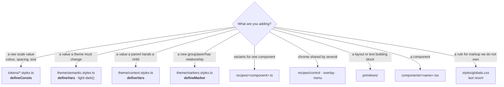

# Catalogue

What already exists. Check here before writing a new token, recipe or primitive —
the point of this file is that you do not rebuild something that is already here
under a different name.

## Where things live



## Layer 1 — tokens (`defineConsts`, emit no CSS)

| File                               | Exports                                                                     | Notes                                                                                                                      |
| ---------------------------------- | --------------------------------------------------------------------------- | -------------------------------------------------------------------------------------------------------------------------- |
| `colors.stylex.ts`                 | `color`                                                                     | The full Tailwind 4.3 palette, 26 hues × 11 steps, in oklch. `color.red500`                                                |
| `spacing.stylex.ts`                | `spacing`                                                                   | Tailwind's scale. `spacing[4]`, `spacing["2.5"]`                                                                           |
| `typography.stylex.ts`             | `fontFamily` `fontSize` `lineHeight` `fontWeight` `letterSpacing` `leading` | `fontSize.sm` pairs with `lineHeight.sm` — always set both. Ratios are stored rounded up; see the file                     |
| `radius` (in `semantic.stylex.ts`) | `radius`                                                                    | A **var**, not a const: roundness is themeable                                                                             |
| `shadows.stylex.ts`                | `shadow`                                                                    | `shadow.sm` … `shadow.2xl`                                                                                                 |
| `blur.stylex.ts`                   | `blur`                                                                      | Lengths for `blur(${blur.xs})`. `backdrop-blur-xs` is 4px, not 2px                                                         |
| `breakpoints.stylex.ts`            | `breakpoint` `screen`                                                       | `breakpoint.md` is a media-query string; `screen.md` is the raw width. `3xl` (100rem) is shadcn's addition, not Tailwind's |
| `container.stylex.ts`              | `container` `containerName` `fieldGroupQuery` `cardHeaderQuery`             | Named container queries                                                                                                    |
| `motion.stylex.ts`                 | `duration` `easing` `motion`                                                | `easing.inOut` for transitions. `easing.cssOut` for ported `animate-*` keyframes. `easing.cssEase` for overlay enter/exit  |
| `z-index.stylex.ts`                | `zIndex`                                                                    | Named layers: `base` … `toast`. `overlay` and `popover` are both 50, as shadcn\'s `z-50`                                   |
| `ring.stylex.ts`                   | `ring`                                                                      | `ring.width` — in a token file because constants used in styles must be                                                    |
| `scroll-fade.stylex.ts`            | `scrollFadeVars`                                                            | A `stylex.types.lengthPercentage`, so it can be animated                                                                   |

## Layer 2 — semantic (`defineVars`, themeable)

All in `theme/semantic.stylex.ts`. Every colour is one `light-dark(<light>, <dark>)`
value; the `color-scheme` ThemeProvider sets decides which half applies.

| Group     | For                                                 | Example                                         |
| --------- | --------------------------------------------------- | ----------------------------------------------- |
| `theme`   | The shadcn palette                                  | `theme.primary`, `theme.mutedForeground`        |
| `alpha`   | Translucent derivatives of `theme`                  | `alpha.ring50`, `alpha.destructive20`           |
| `surface` | Component intent that differs structurally per mode | `surface.control`, `surface.inactiveForeground` |
| `radius`  | The derived roundness scale                         | `radius.lg`                                     |

`theme/themes.ts` holds only `modeThemes`: one small `createTheme` per mode for
the three surface tokens that are not colours (`imageRingBlend`,
`imageBrightness`, `imageDim`), since `light-dark()` only takes colours.

> **Adding a colour token** is one line: `name: "light-dark(<light>, <dark>)"`.
> A token derived from another (`color-mix` over `theme.x`, or
> `light-dark(${theme.muted}, ${theme.background})`) needs nothing more. Both
> functions stay unresolved inside the variable and are computed on the element
> that uses it, so it follows the mode. A new **non-colour** per-mode token goes
> in `surface` with its light value as the default, and in all three `modeThemes`.

## Layer 3 — conditions

**`theme/markers.stylex.ts`** — 32 markers, one per relationship that is
actually read. Import by name: `import { cardMarker } from "../theme/markers.stylex"`.

A marker earns its place only when some element spreads it **and** some
`stylex.when.*` reads it. It goes on the element its selector describes, which
for a sibling query is the sibling. `has-*` needs no marker: use a `":has(…)"`
key. `bun run check:stylex` enforces all of this, so a new marker must be used
in the same change that adds it.

**`theme/context.stylex.ts`** — values a parent hands to a child:

| Var                   | Set by                                                       | Read by                                                                  |
| --------------------- | ------------------------------------------------------------ | ------------------------------------------------------------------------ |
| `ctx.iconSize`        | every control                                                | the `Icon` primitive                                                     |
| `ctx.cardSpacing`     | `Card`, picked by `size`                                     | its header, content, footer                                              |
| `ctx.gap`             | a layout that spaces its groups (the blocks canvas)          | the columns and nested grids inside it                                   |
| `ctx.controlPadding*` | `InputGroup`                                                 | the control inside it                                                    |
| `ctx.skeletonWidth`   | `SidebarMenuSkeleton`                                        | `Skeleton`                                                               |
| `menuCtx.*`           | a menu popup, via `menuStyles.content` or `menuStyles.glass` | its rows and separators: highlight, destructive colour, separator colour |
| `toastCtx.*`          | `Toast`                                                      | the stack transform                                                      |
| `drawerCtx.*`         | `Drawer`                                                     | the gesture transform                                                    |
| `sidebarCtx.*`        | `SidebarProvider`                                            | the sidebar's parts                                                      |
| `calendarCtx.*`       | `Calendar`                                                   | its grid                                                                 |

To change one responsively from outside, set the narrow value on an ancestor and
the wider one with `default: null` on the element: a custom property's plain
value is emitted outside the cascade layers and would beat a breakpoint written
beside it. `calendar-example.tsx` does this for `calendarCtx.cellSize`.

Every default in `context.stylex.ts` is inert. The component that sets a variable
assigns its real value on its own element, because a default is evaluated on
`:root`: there it cannot see a library's element-level variables.

**`theme/animations.stylex.ts`** — `animation.spin` `pulse` `caretBlink`
`shimmer`. Keyframes must be used in the file that declares them, so they are
shared through `defineVars`.

## Layer 4 — recipes

| Export                                      | From                      | Use for                                                                                           |
| ------------------------------------------- | ------------------------- | ------------------------------------------------------------------------------------------------- |
| `recipe()`                                  | `recipes/recipe.ts`       | Any variant set. The `cva` replacement                                                            |
| `button`, `buttonRing`                      | `recipes/button.ts`       | Buttons, and anything that should look like one. `buttonLabel` trims element labels to cap height |
| `badge`, `badgeRing`                        | `recipes/badge.ts`        | Badges                                                                                            |
| `toggle`                                    | `recipes/toggle.ts`       | Toggle and ToggleGroupItem                                                                        |
| `buttonGroup`, `groupedItem`, `groupedFill` | `recipes/button-group.ts` | A control that can sit in a ButtonGroup                                                           |
| `controlStyles`                             | `recipes/control.ts`      | Anything that reads as a form field                                                               |
| `overlayStyles`                             | `recipes/overlay.ts`      | Enter/exit motion: `popup` `modal` `panel` `backdrop`                                             |
| `menuStyles`, `menuItem`                    | `recipes/menu.ts`         | Any menu-shaped popup. `content` is solid; add `glass` after it for the translucent surface       |
| `scrollFadeStyles`                          | `recipes/scroll-fade.ts`  | Fading a scroll container's edge                                                                  |

Menus come in two surfaces, matching the originals. ContextMenu and Menubar are
solid: `accent` highlight, red destructive rows, `border` separators.
DropdownMenu, Select and Combobox are glass: `foreground/10` highlight,
destructive rows in the normal text colour, `foreground/5` separators. The rows
never know which they are in; they read `menuCtx`.

Using a recipe:

```tsx
<button sx={[buttonMarker, buttonRing, ...button({ variant, size }), sx]} />
```

Order matters: marker, then ring, then the recipe, then `sx` last so callers can
override.

## Layer 5 — primitives

| Component        | For                                                                                          |
| ---------------- | -------------------------------------------------------------------------------------------- |
| `Box`            | A div with padding, background, radius props                                                 |
| `Flex` / `Stack` | Rows and columns. `Stack` is a `Flex` that defaults to column                                |
| `Grid`           | Column counts, gaps, `center`                                                                |
| `Text`           | Sizes, weights, colours, `truncate`, `clamp`, `heading`                                      |
| `Icon`           | **Always** use this instead of `HugeiconsIcon`. Reads `ctx.iconSize`; stroke defaults to 2   |
| `Link`           | Inline links. Replaces `[&_a]` descendant styling                                            |
| `VisuallyHidden` | Replaces `sr-only`. Capped at 1px wide, so a vertical Field's full-width rule cannot grow it |

Props index into precompiled tables in `primitives/styles.ts`. The vocabulary is
deliberately narrow: layout and the semantic palette, nothing else. Anything more
specific belongs in a component's own `stylex.create`, where it is named and
reviewable.

## Layer 6 — components

61 files in `components/`, each taking `sx?: Sx` instead of `className`.
`lib/sx.ts` has the `Sx` type, the React augmentation that types `sx` on every
DOM and SVG element, and `mergeSx`.

> Compose with an array, `sx={[a, b, sx]}`, on elements and components alike.
> `mergeSx(a, b)` is the same thing as a call, for props built outside JSX.

Parts that style something the caller renders take a second style prop, named
for what it reaches:

| Component                 | Prop                              | Styles                                                                                         |
| ------------------------- | --------------------------------- | ---------------------------------------------------------------------------------------------- |
| `Progress`                | `indicatorSx`                     | the filled bar it renders for you                                                              |
| `ComboboxInput`           | `inputSx`                         | the text input inside its InputGroup                                                           |
| `Calendar`                | `modifiersSx`                     | days carrying a modifier: `{ booked: { day, button } }`                                        |
| `Example` (apps/examples) | `containerSx`                     | the column around the title and card                                                           |
| `NavigationMenuLink`      | `sx={navigationMenuTriggerStyle}` | a plain link that should look like the triggers beside it                                      |
| `Sidebar`                 | `innerSx`                         | the inner panel holding the content, e.g. `flexDirection: "row"` for two side-by-side sidebars |
| `FieldSeparator`          | `contentSx`                       | the label that interrupts the line, e.g. its fill on a card                                    |

Some forms are detected rather than opted into, matching the original:
`FieldLabel` becomes a selectable card when it wraps a `Field`; a table body's
or footer's last row drops its rule; a `ToggleGroup` joins its items at
`spacing={0}` (it also accepts `1` and `2`). A `TabsTrigger` reads its orientation and active state from Base UI and its list's variant from context, so the line indicator needs no props. The unstyled `Collapsible` parts keep a class another component hands them, so `<SidebarMenuButton render={<CollapsibleTrigger />}>` still looks like the button. `AlertIcon` renders the svg itself
(`<AlertIcon icon={AlertCircleIcon} />`) and an alert's descriptions turn
destructive with the alert.

## Global CSS

`styles/globals.css` holds what StyleX cannot express, each block scoped by the
`data-slot` it serves:

| Block              | Why it is not StyleX                                                                                            | Layer     |
| ------------------ | --------------------------------------------------------------------------------------------------------------- | --------- |
| Reset              | Structural defaults, Tailwind's preflight where components relied on it                                         | `reset`   |
| Recharts internals | Markup a library renders with its own class names                                                               | `base`    |
| Inline content     | Links and paragraphs a caller writes inside an alert, an accordion panel, or a field, empty or item description | `base`    |
| Calendar day meta  | A span a custom `DayButton` renders beneath the date                                                            | `base`    |
| Sidebar label      | The plain span a caller puts last in a sidebar menu button truncates                                            | `base`    |
| Field layout       | A Field stretches whatever children it is given, over their own width — as `*:w-full` did                       | unlayered |

None of it names a token: hashed names cannot be written in plain CSS. Where a
rule needs a theme colour, the component hands it down as a plain custom
property, as `--inline-link-hover` does.

## The shell (`packages/shell`)

The frame shared by `apps/blocks` and `apps/examples`. It knows nothing about
either app: each passes its `NavGroup[]`.

| Export          | For                                                                                                                                                                  |
| --------------- | -------------------------------------------------------------------------------------------------------------------------------------------------------------------- |
| `nav.ts`        | `NavItem`, `NavGroup`, `filterNav` for search, `flattenNav` for every leaf. An item with `items` renders as a collapsible sub-menu                                   |
| `AppShell`      | Sidebar of groups, sticky header with title, search and theme                                                                                                        |
| `SearchCommand` | The ⌘K palette in the header                                                                                                                                         |
| `SearchPage`    | `/search?q=` — a filter box and the matching items                                                                                                                   |
| `IndexPage`     | A card grid per nav group, for an app's home route                                                                                                                   |
| `PreviewFrame`  | Centres one block card on the page background                                                                                                                        |
| `BlockViewer`   | A full-page block in an iframe on its bare `/view/<name>` route, with a width toggle and an Open link. The iframe starts in the header's colour scheme via `?theme=` |
| `PageLoading`   | The suspense fallback while a lazy page loads                                                                                                                        |
| `ThemeToggle`   | The three-way light / dark / system switch                                                                                                                           |
