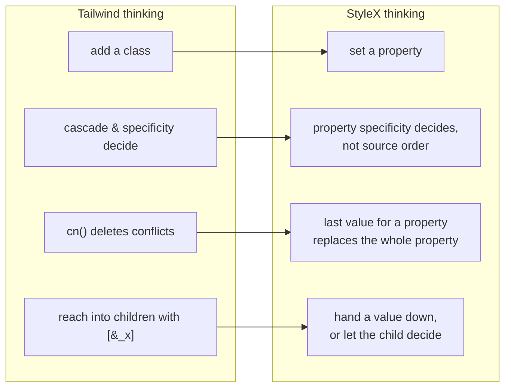
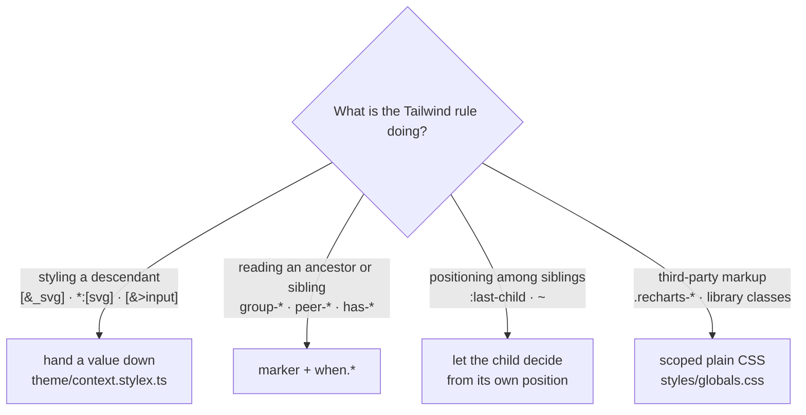
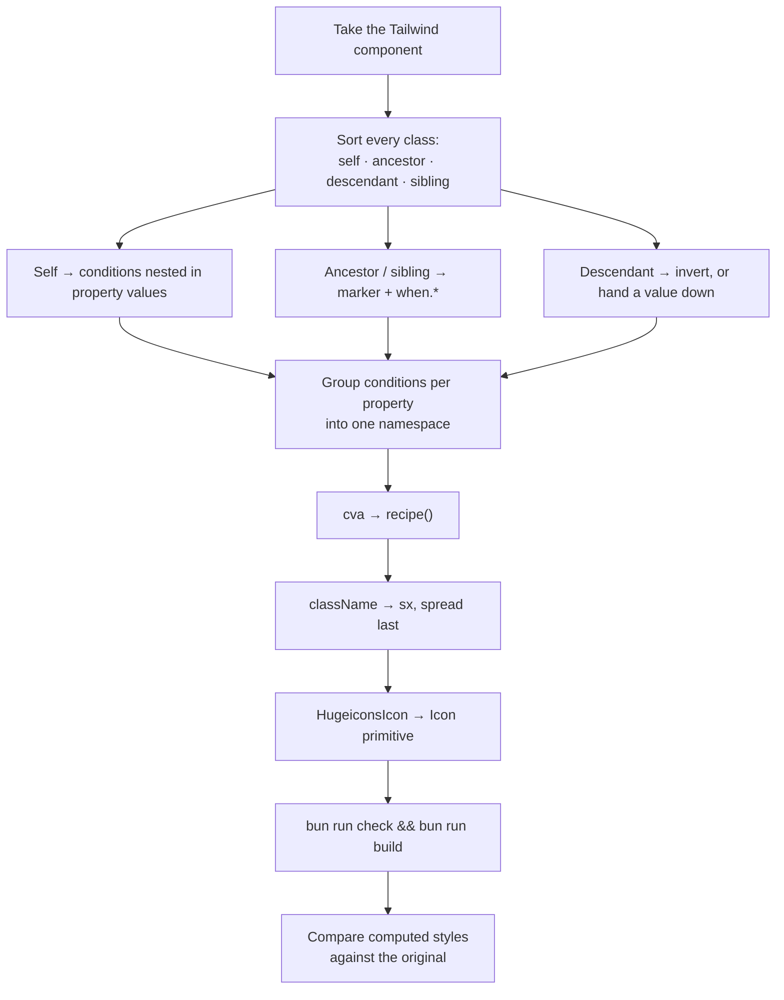

# Porting from Tailwind

## The shift in point of view

Tailwind is a **vocabulary of classes** resolved by the cascade. StyleX is a
**compiler over typed objects** resolved by property. Four consequences follow,
and nearly every porting mistake traces back to one of them.



1. **A style is a property, not a class.** You cannot "add one more class" to
   nudge something. You set the property, and whoever sets it last owns it.
2. **Conflicts resolve by property specificity, not order.** A `padding`
   shorthand loses to a `paddingTop` longhand no matter which is applied later.
3. **Re-declaring a property discards its conditions.** This is the single
   biggest source of subtle bugs. See the pitfalls below.
4. **You cannot style what you do not render.** No descendant, child or arbitrary
   selectors. The relationship has to be inverted or handed down.

## The mapping table

The governing syntax rule: pseudo-classes, attribute selectors and at-rules nest
**inside a property value**. Only pseudo-_elements_ are top-level keys.

| Tailwind                             | Here                                                                                                 |
| ------------------------------------ | ---------------------------------------------------------------------------------------------------- |
| `bg-red-500`                         | `backgroundColor: color.red500`                                                                      |
| `bg-primary`                         | `backgroundColor: theme.primary`                                                                     |
| `bg-primary/80`                      | `backgroundColor: alpha.primary80`                                                                   |
| `p-4`, `gap-2`                       | `padding: spacing[4]`, `gap: spacing[2]`                                                             |
| `rounded-lg`                         | `borderRadius: radius.lg`                                                                            |
| `text-sm`                            | `fontSize: fontSize.sm` **and** `lineHeight: lineHeight.sm`                                          |
| `md:p-6`                             | `padding: { default: spacing[4], [breakpoint.md]: spacing[6] }`                                      |
| `dark:bg-card`                       | nothing — the token is `light-dark()`; if structural, a `surface.*` token                            |
| `bg-muted dark:bg-background` once   | `` `light-dark(${theme.muted}, ${theme.background})` `` inline, or a `surface.*` token if it repeats |
| `hover:`, `disabled:`                | `{ default: x, ":hover": y }`                                                                        |
| `data-[state=open]:`                 | `{ default: x, '[data-state="open"]': y }`                                                           |
| `aria-invalid:`                      | `{ default: x, '[aria-invalid="true"]': y }`                                                         |
| `placeholder:`                       | `"::placeholder": { … }` as a top-level key                                                          |
| `group-data-[state=open]:`           | `[stylex.when.ancestor('[data-state="open"]', fooMarker)]`                                           |
| `peer-disabled:`                     | `[stylex.when.siblingBefore(":disabled", fooMarker)]`                                                |
| `has-[:focus-visible]:`              | `":has(:focus-visible)"`, no marker                                                                  |
| `group-has-[:disabled]/field:`       | `[stylex.when.ancestor(":has(:disabled)", fieldMarker)]`                                             |
| `in-data-[slot=x]:`                  | `[stylex.when.ancestor('[data-slot="x"]', xMarker)]`                                                 |
| `@container/name` + `@md/name:`      | `containerName` + `'@container name (min-width: …)'`                                                 |
| `animate-in fade-in-0`               | transitions against `data-starting-style`                                                            |
| `animate-spin`                       | `stylex.keyframes`, shared via `theme/animations.stylex.ts`                                          |
| `ring-3`                             | `boxShadow: \`0 0 0 ${ring.width} …\``                                                               |
| `transition-colors`                  | longhands + `duration[150]` + `easing.inOut`                                                         |
| `transition-all` on a moved element  | name the property you animate — `translate`, not `transform`                                         |
| `sr-only`                            | the `VisuallyHidden` primitive                                                                       |
| `no-scrollbar`                       | `scrollbarWidth: "none"` + `"::-webkit-scrollbar"`                                                   |
| `line-clamp-2`                       | `Text clamp="2"`, or the four `-webkit-box` properties                                               |
| `className={cn(a, b)}` on an element | `sx={[a, b]}` — StyleX's own shorthand, compiled to `stylex.props`                                   |
| `!important`                         | nothing — reorder the `sx` array instead                                                             |
| `[class*='size-']`                   | nothing — class names are hashed. Use an explicit prop                                               |

### Defaults worth memorising

Tailwind's bare `transition-*` utilities imply `150ms` and
`cubic-bezier(0.4, 0, 0.2, 1)`. That curve is `easing.inOut` here, **not**
`easing.out`. An unadorned `transition-colors` ports to:

```ts
transitionProperty: "color, background-color",
transitionDuration: duration[150],
transitionTimingFunction: easing.inOut,
```

Tailwind's font-size utilities set a **paired line-height**. `fontSize` alone
leaves text on the document's 1.5, which is about a pixel taller per line and
shifts every box around it.

**Read the custom variants before trusting a data attribute.** shadcn defines
`data-open:`, `data-selected:` and friends in its own stylesheet, and they are
not all presence checks. `data-selected:` means `[data-selected="true"]`,
because cmdk writes `"true"` or `"false"` on every row. Base UI adds and removes
its attributes instead, so presence selectors are right there. When a library
writes `="false"`, port to the `="true"` form.

**`cn` deleted classes, and the deletion was part of the design.** When a
component wrote `text-sm` and a variant added `text-[0.8rem]`, `cn` dropped
`text-sm` entirely, line-height included. StyleX merges per property, so the
base's line-height survives. Restate what the deletion removed, usually as
`inherit`. Compare computed values to catch these; the class string will not
show it.

A few smaller translations that are easy to get slightly wrong:

| Tailwind                       | Correct port                                                               | Not                                                                                                                               |
| ------------------------------ | -------------------------------------------------------------------------- | --------------------------------------------------------------------------------------------------------------------------------- |
| `top-1/3`                      | `calc(100% / 3)`                                                           | `33%`, which is 3px off on a 900px viewport                                                                                       |
| `shadow-md ring-1`             | ring layer first, then `shadow.md`                                         | shadow first. Tailwind emits ring before shadow, and the first layer paints on top                                                |
| `animate-accordion-down`       | `stylex.keyframes`, `easing.cssOut`                                        | a transition, or `easing.out`. `tw-animate-css` uses the CSS `ease-out` keyword                                                   |
| `p-0` on an icon button        | the four padding longhands                                                 | `padding: 0`, which loses to the button's `paddingInline`                                                                         |
| padding on a `span`            | add `display: "block"`                                                     | vertical padding on an inline box, which does not grow the line                                                                   |
| `backdrop-blur-xs`             | `` `blur(${blur.xs})` ``                                                   | a guessed pixel value. The scale is in `tokens/blur.stylex.ts`                                                                    |
| `animate-in duration-100`      | a transition at `duration[100]`, `easing.cssEase`                          | Tailwind's transition defaults. `tw-animate-css` uses the CSS `ease` keyword                                                      |
| `calc(1.25 / 0.875)`           | the rounded-up ratio in `lineHeight`                                       | the expression, which the minifier rounds down to 1/64px short                                                                    |
| text in a fixed-height control | the label wrapped in an element with `textBox: "trim-both cap alphabetic"` | a centred line box. Inter's capitals sit up to 3px high once the baseline snaps, and by a different amount per sub-pixel position |

## The four patterns that cannot be translated



**1. Descendant selectors.** `[&_svg:not([class*='size-'])]:size-4` appeared 25
times. Neither half survives. Replaced by the `Icon` primitive reading a
`ctx.iconSize` variable each control sets. Same handoff replaced `[&>input]`,
`*:[img:first-child]` and `[&_a]` — the last became the `Link` primitive.

**2. Parent-driven child styling.** `ButtonGroup` styled its children's corners
from the parent. Inverted: the group carries a marker, each child decides its own
corners from its own position.

**3. Position among injected siblings.** Base UI injects focus-guard elements
while a popup is open, so `:last-child` silently stops matching. Use
`:not(:has(~ [data-slot]))` — "last real control" — which is what the Tailwind
original matched on.

**4. Markup the component does not own.** Recharts renders its own SVG with
fixed class names and hard-coded `#ccc`. A Field lays out whatever children it is
handed; an alert description holds the caller's links and paragraphs. None of
that can receive a style, so it stays in `globals.css`, scoped by `data-slot`.
The catalogue lists every block and why. Prefer a context variable or a prop
when the child is a component of ours.

## Pitfalls

Ordered by how much time each one cost.

### `stylex.when.*` must be called inline

Inside the `stylex.create` object, as a computed key. Hoisting it into a module
constant compiles fine and produces correct CSS, but leaves a real function call
behind that throws `Unexpected 'stylex.when.ancestor' call at runtime` on the
server. It is tempting because it reads better. Do not.

```ts
// wrong — throws at runtime
const OPEN = stylex.when.ancestor('[data-state="open"]', cardMarker)
const styles = stylex.create({ x: { opacity: { default: 0.5, [OPEN]: 1 } } })

// right
const styles = stylex.create({
  x: {
    opacity: {
      default: 0.5,
      [stylex.when.ancestor('[data-state="open"]', cardMarker)]: 1,
    },
  },
})
```

A plain _string_ constant for the selector text is fine — only the `when.*` call
itself has to be inline.

### A property's conditions must all be declared together

Styles merge per property. A later style that sets `borderColor` replaces the
earlier one **including its conditions**. This bites quietly, because the result
still compiles and still looks nearly right.

It caused two real bugs here: the alert dialog lost its centring because a second
namespace re-declared `placeItems` to add a breakpoint, and a toggle group lost
its selected highlight because each weight re-declared `backgroundColor` with
only `default` and `:hover`.

> **If a variant touches a property, it owns every condition on that property.**

This is why `recipes/control.ts`, `recipes/overlay.ts` and `recipes/menu.ts`
exist — they keep related conditional properties in one namespace.

### Shorthands lose to longhands regardless of order

`padding: 0` passed through `sx` will not override a component's own
`paddingTop`. Match the specificity: pass `paddingTop` and `paddingBottom`.
Tailwind's `cn` hid this by deleting the conflicting class outright.

The same applies inside the design system. Button sets `paddingInline` plus
conditional `paddingInlineStart` and `paddingInlineEnd`, so a style that zeroes
a button's padding must set all four longhands. Three components got this wrong
and kept 10px of side padding inside fixed-size icon buttons. Before writing `padding: 0`,
look at what it is merged over.

It holds for plain values only. A condition raises a rule's priority further
than the longhand bonus does, so `borderRadius: { '[data-range-middle="true"]': 0 }`
beats a longhand written as a `when.ancestor` query. The calendar's week-row
corners disappeared that way. Nest the longhand's query inside the same
attribute when both must apply.

A `px-*` in `sx` also replaces a Button's icon-side padding, which in Tailwind
was a `has-*` variant that outranked the caller's utility and survived. Restate
it: `{ default: spacing["2.5"], ':has([data-icon="inline-start"])': spacing[2] }`.

### Constants used inside `stylex.create` must come from a `.stylex.ts` file

A plain `export const RING = "3px"` in an ordinary module fails with "Could not
resolve the path to the imported file" the moment another module uses it in a
style. Put it in `defineConsts`. A constant local to the same file is fine.

### Import tokens and markers by name

A namespace import (`import * as markers`) fails with "Referenced constant is not
defined".

### Banned shorthands

`background`, `transition` and `grid` are hard compiler errors. Use longhands.

### Animate the property you actually set

`translate`, `scale` and `rotate` are separate animatable properties.
`transitionProperty: "transform"` does not cover them — the element jumps instead
of easing.

### Breakpoints on one property must not overlap

`padding: { default: 4, [breakpoint.sm]: 6, [breakpoint.lg]: 12 }` looks like
Tailwind's `p-4 sm:p-6 lg:p-12`, but StyleX gives every `@media` rule the same
priority. When two breakpoints match, the winner depends on CSS insertion order,
which is not sorted by width. In the demo the page padding stayed at `sm` on a
wide screen. Make the ranges exclusive:

```ts
padding: {
  default: spacing[4],
  "@media (min-width: 40rem) and (max-width: 63.999rem)": spacing[6],
  [breakpoint.lg]: spacing[12],
},
```

### Tailwind variants beat bare breakpoints; StyleX does the opposite

In Tailwind, `group-*`, `peer-*`, `has-*`, `hover:` and data variants all carry
more CSS specificity than a bare `md:` utility, so the variant wins at every
width. StyleX ranks `@media` and `@container` above relational and pseudo-class
conditions. Writing the two side by side flips the outcome:

```ts
// group-data-[swipe-axis=y]/drawer-popup:text-center md:text-start
// wrong: at md and up, "start" beats the centring
textAlign: { default: null, [stylex.when.ancestor('[data-swipe-axis="y"]', m)]: "center", [breakpoint.md]: "start" },

// right: restate the variant inside the breakpoint
textAlign: {
  default: null,
  [stylex.when.ancestor('[data-swipe-axis="y"]', m)]: "center",
  [breakpoint.md]: { default: "start", [stylex.when.ancestor('[data-swipe-axis="y"]', m)]: "center" },
},
```

The drawer header lost its centring on desktop this way, and the sidebar's menu
action never appeared on hover.

The same inversion exists between conditions. In StyleX an attribute key such as
`'[aria-expanded="true"]'` outranks `":hover"`, while Tailwind's stacked
`dark:hover:` out-specifies `aria-expanded:`. When the original lets a stacked
variant win, nest it inside the condition it beats, as the outline button does
with hover inside its open state. `bun run check:stylex` flags a property that
holds a plain breakpoint value beside a relational or pseudo-class key.

### A later `default: null` removes the earlier value

`null` does not mean "keep what the previous style set". Once a namespace sets a
property, it owns that property in the merge, and `null` leaves it unset. The
calendar's day buttons wrote `borderRadius: { default: null, … }` over the
Button recipe and lost their rounded corners. Restate the value you want to keep:
`default: radius.lg`. `null` is right only when nothing earlier sets the
property, as in the next section.

### Styling the element a part renders as

Base UI merges a part's `className` with its `render` element's by
concatenating strings. If both carry StyleX classes for the same property, the
cascade picks a winner and StyleX's merge never runs. Pass the part's styles as
`sx` to the rendered component instead; `withSx` in `components/toast.tsx` does
this for the toast's action and close buttons.

The reverse fails more quietly. One of our components used as the `render`
element — `render={<ComboboxTrigger />}`, `render={<Label />}` — takes `sx`, not
`className`, so the classes the outer part hands it are dropped and the outer
part renders unstyled. Compose the other way round: the unstyled primitive
renders the styled component (`<ComboboxPrimitive.Trigger render={<InputGroupButton />}>`),
or render a plain element.

### A conditional custom property needs a `null` default

```ts
// wrong: the default wins, the condition never applies
[drawerCtx.closedTransform]: { default: "none", '[data-side="down"]': "…" },

// right: the default comes from defineVars, on :root, and is merely inherited
[drawerCtx.closedTransform]: { default: null, '[data-side="down"]': "…" },
```

With `useCSSLayers`, StyleX wraps each priority group in a cascade layer except
the lowest, and a custom property's plain value lives in that lowest group. It is
emitted **unlayered**, and an unlayered rule beats every layered one whatever
its specificity. Attribute, pseudo-class and `@media` conditions are layered, so
they never apply. (`:has()` and `when.*` conditions share the unlayered group
and do work.) The drawer did not animate, every small Card kept the default
spacing, and a snap-point drawer's overlay never dimmed, all for this reason.

If a value must apply unconditionally and also be overridden, pick the style in
JavaScript (`size === "sm" ? styles.sizeSm : styles.sizeDefault`), or set the
plain value on an ancestor and write the condition with `default: null`.
`bun run check:stylex` fails on a plain default beside a layered condition.

### `defineVars` defaults are evaluated on `:root`

A default that reads a variable a library sets further down, such as
`var(--nested-drawers)` or `var(--toast-index)`, is invalid on `:root`. An
invalid custom property then poisons every value composed from it, so the whole
`transform` silently computed to `none`. Keep defaults inert and assign the
real formula on the element that owns the library's variables.
`bun run check:stylex` flags a default that reads a variable with no fallback.

It is also why every colour is a `light-dark()` pair rather than a palette
swapped by a theme below `:root`: a default that named a swapped token would
have been resolved against the light palette on `:root`. `light-dark()` stays
unresolved in the variable and computes wherever it is used.

### The marker goes on the element the selector describes

`stylex.when.descendant(sel, m)` compiles to `:has(.m<sel>)`. The selector and
the marker both describe the **descendant**. Putting `m` on the container, which
reads naturally, compiles cleanly and never matches. The port made that mistake
in all 36 of its `has-*` translations: icon padding in buttons, toggles, badges
and tabs, the card footer, the alert icon, item media, and more.

Use the form that matches the question:

```ts
// has-data-[icon=inline-end]:pe-2 — "do I contain it"
paddingInlineEnd: { default: spacing["2.5"], ':has([data-icon="inline-end"])': spacing[2] },

// group-has-data-[slot=item-description]/item:self-start — "does my ancestor contain it"
alignSelf: {
  default: null,
  [stylex.when.ancestor(':has([data-slot="item-description"])', itemMarker)]: "flex-start",
},
```

Both keys sit below `:hover` and attribute conditions in StyleX's priority order,
the same place the broken rules sat. The sibling queries follow the same rule:
in `when.siblingBefore(sel, m)` the marker is on the earlier sibling. That is why
the command palette's check reads a `commandShortcutMarker` placed on the
shortcut. `bun run check:stylex` flags a descendant or sibling query whose
marker is not on the slot its selector names.

### A marker nobody applies is a silent no-op

A condition reading a marker that no element carries compiles and never matches.
The calendar kept an opaque background inside popovers for this reason.
`bun run check:stylex` fails on markers that are read but never applied, applied
but never read, or unused.

### shadcn examples still speak Radix

The registry's examples and blocks were written against Radix attributes, and
some of them survived into the Base UI versions where they never match:
`data-[state=open]` and `data-open` on a collapsible trigger (Base UI marks it
`data-panel-open`), `data-open` on a menu trigger (`data-popup-open`),
`data-[state=on]` on a toggle (`aria-pressed`), and `group-data-[disabled=true]`
reading an unnamed `group` that `Field` does not set. Port the intent with the
attribute Base UI renders, and fix the Tailwind original to match, so the
comparison sees the same behaviour on both sides.

### Markup and variables the blocks bring with them

- **An inline brand logo** (`<svg>` in a "Login with Google" button) was sized by
  the button's `[&_svg]:size-4`. It cannot read that now; give it
  `width: ctx.iconSize` and `height: ctx.iconSize`.
- **`style={{ "--sidebar-width": … }}`** on a SidebarProvider set Tailwind's
  variable. The port's width is `sidebarCtx.width`, a hashed name, so set it in
  `sx`. The same goes for `--cell-size` (`calendarCtx.cellSize`).
- **A local wrapper spread with `stylex.props(...)`** passes `className` down to
  one of our components, which drops it. Pass `sx` instead. On a lowercase
  element `sx` compiles to that same spread; on a component it stays a prop.
- **Radix leftovers in sidebars**: `data-open:` on a dropdown or popover trigger
  is `data-popup-open`, on a collapsible trigger `data-panel-open`.

### Pseudo-elements with a state or a direction

`hover:after:bg-x` is a condition inside the pseudo-element's own property:

```ts
"::after": {
  backgroundColor: { default: null, ":hover": theme.sidebarBorder },
}
```

That compiles to `.x:hover::after`. An ancestor or attribute condition works the
same way (`.x[data-swipe-direction="up"]::after`). When the original sets a
pseudo-element's position per direction —
`data-[swipe-direction=up]:after:bottom-full`,
`data-[swipe-direction=left]:after:end-full` — keep every direction. The port
first placed the drawer's bleed after the popup for all four, so top and left
drawers showed a 48px strip beside the panel.

### Wrappers must keep the original's default props

A component that wraps another often changed its defaults, not just its classes:
`MenubarContent` passes `align="start" alignOffset={-4} sideOffset={8}` and a
wider `min-w-36` to the dropdown it wraps. Porting only the styles leaves the
menu 4px off and 48px narrower. Read the function signature, not just
`className`.

The reverse matters as much: a prop the wrapper destructures for its own
styling must still reach the primitive when the primitive uses it. `Tabs` and
`ToggleGroup` took `orientation` to write `data-orientation` and never passed it
on, in the original too, so Base UI kept vertical groups horizontal: arrow keys
moved the wrong way, and each tab's `state.orientation` stayed `"horizontal"`.

And prefer the attribute the library already writes to a prop of your own.
`ResizableHandle` grew an `orientation` prop to pick its hit strip and grip
rotation, which no caller passed; the library sets `aria-orientation` on the
handle, so `'[aria-orientation="horizontal"]'` conditions (inside `::after`,
and `when.ancestor` with the default marker for the grip) follow the group with
no prop at all.

### Utilities that do less than their name

- `shadow-none` clears only the drop shadow. A Card keeps its `ring-1`, so do
  not translate it to `boxShadow: "none"`.
- `border` sets a width and inherits the style. On an `Empty`, which is
  `border-dashed`, it draws a dashed line: add widths only. The converter wrote
  `borderTopStyle: "solid"` and friends beside the widths, which beat the
  component's `borderStyle` shorthand, and three dashed Empties went solid.
- `data-open`, `data-closed`, `data-checked`, `data-unchecked`, `data-selected`,
  `data-disabled`, `data-active`, `data-horizontal` and `data-vertical` are
  shadcn's custom variants (`shadcn-tailwind.css` in the original), not
  attribute-presence checks. `data-horizontal` is
  `[data-orientation="horizontal"]`; `data-open` matches `[data-state="open"]`
  or a `data-open` that is not `"false"`. Look the variant up before
  translating it.
- `group-has-*` asks whether the group **contains** a match, never the group
  itself. `group-has-data-horizontal/field:text-balance` balances a description
  in a field that holds a slider, not in every horizontal field:
  `when.ancestor(':has([data-orientation="horizontal"])', fieldMarker)`. The
  port first balanced every horizontal field's description.
- `[&>a]:underline` on a description part styles links the caller writes into
  it. StyleX cannot reach them, so it is a `globals.css` rule scoped to the
  part's `data-slot`, with the hover colour handed down as
  `--inline-link-hover`. Field, Empty and Item descriptions lost their link
  underlines until that rule existed.
- `*:[div:not([class*='w-'])]:w-full` skips any child whose class _contains_
  `w-` — `max-w-*`, and `overflow-hidden` too. Check which children it really
  reached before reproducing it.

## The process



Step 9 is not optional. Screenshots miss about a pixel of line-height, a wrong
easing curve, and a variant that quietly dropped a state.
[workflows.md](workflows.md) has the method.
