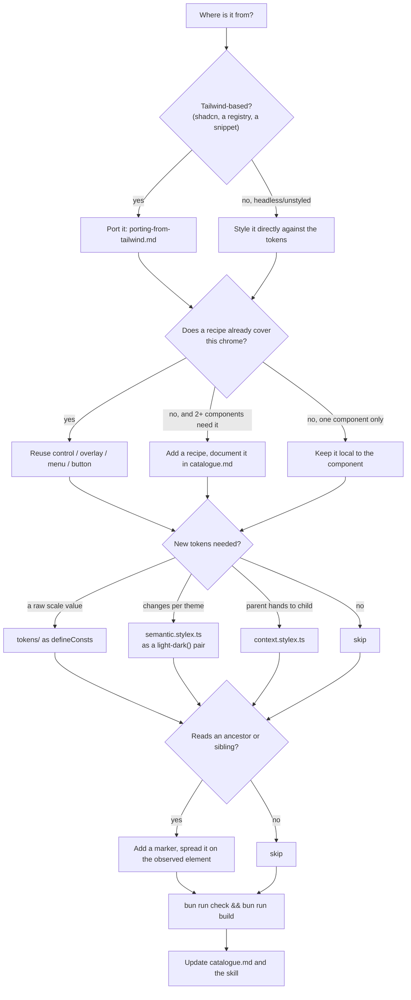
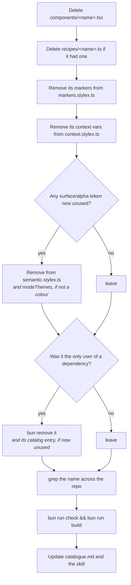
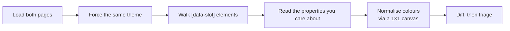
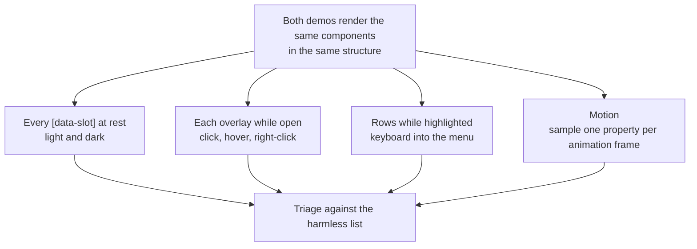
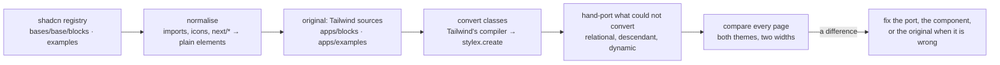
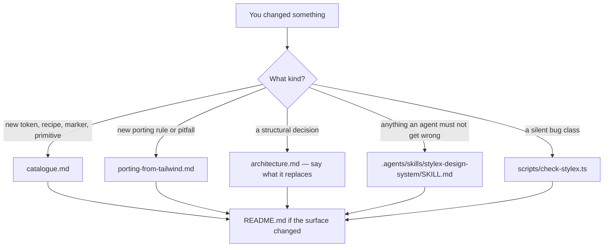

# Workflows

## Adding a component



Concretely, for a component that arrives as Tailwind:

1. **Read the classes before writing anything.** Sort them into self-state,
   ancestor, descendant and sibling. That sort decides the whole shape.
2. **Check the catalogue.** Most chrome already exists. A new popup is
   `overlayStyles` + `menuStyles`; a new field is `controlStyles.field`.
3. **Swap the dependencies.** `cn` → `sx={[…]}` on elements, `cva` → `recipe()`,
   `lucide-react` → `@hugeicons/core-free-icons` via the `Icon` primitive,
   `@/components/ui/x` → a relative import, `className` → `sx`.
4. **Group conditions per property.** Every condition on one property in one
   namespace. This is where the bugs are.
5. **Verify against the source** if one exists, with the computed-style diff
   below.

If the component needs a library that is not installed, install it — but check
first whether it is really needed. Versions shared by more than one workspace
live once, in the Bun catalog in the root `package.json`
(`"workspaces": { "catalog": { … } }`), and each workspace lists them as
`"catalog:"`. A library only one workspace uses stays a plain version in that
workspace's own `package.json`. When a second workspace starts using it, move
the version into the catalog. `attachment.tsx` and `aspect-ratio.tsx`
arrived as documentation demos importing components that did not exist; the right
move was writing the component the demo implied, not adding Next.js.

### Intra-package imports must be relative

Inside `packages/ui`, import with `../theme/semantic.stylex`, never
`@workspace/ui/...`. StyleX resolves `.stylex` imports itself and cannot follow
the package alias from inside the package.

## Removing a component

Deleting the file is the easy half. The rest is the state it left behind — and
StyleX will not warn you, because unused `defineVars` still emit CSS.



The checklist, in grep form:

```bash
NAME=drawer
grep -rn "$NAME" packages/ui/src apps/web/src   # imports, re-exports, demo usage
grep -n "${NAME}Marker" packages/ui/src/theme/markers.stylex.ts
grep -n "${NAME}Ctx\|${NAME}" packages/ui/src/theme/context.stylex.ts
```

Then run `bun run check:stylex`. It names any marker the deletion left applied
but unread, or read but unapplied, so a missed marker cannot survive the change.

**What is exclusive and what is shared.** Safe to delete with the component:

- its own `recipes/<name>.ts`
- markers named after it (`drawerPopupMarker`)
- context vars named after it (`drawerCtx`)

Not safe without checking — these are shared:

- anything in `tokens/` (the vocabulary, not per-component)
- `theme` and `alpha` tokens
- `surface` tokens — several are used by one component _today_ but are named by
  intent, not by component. Grep before removing
- `recipes/control`, `overlay`, `menu`, `button-group`, `recipe`
- everything in `primitives/`

A colour token is a single `light-dark()` line, so removing it is one edit. The
three non-colour `surface` tokens are also set in each of `modeThemes` in
`theme/themes.ts`; remove one there too, or the build breaks.

## Verifying a port

Screenshots miss a pixel of line-height, a wrong easing curve, and a variant that
quietly dropped a state. Compare computed styles instead.



Normalise colours by letting the browser convert them to one space. Set
`background-color: color-mix(in srgb, <colour> 100%, transparent)` on a probe
element and read the computed value back; it comes out as `color(srgb …)` for
every input notation. A canvas `fillStyle` does **not** work in current Chrome:
it keeps `lab()` and `oklch()` strings as written, so every colour looks
different.

### Sweep interactions, not just the page at rest

Most bugs only show in a state. Drive every interactive part of the demo
(each overlay open, a menu row highlighted, a toast shown, an accordion or
collapsible toggled, a tab switched, a button hovered, an input focused) at a
narrow, a medium and a wide viewport. After each action, compare every
`[data-slot]` on the page, portals included, by computed style and bounding box.
Breakpoint bugs only appear at the right width, and a component the demo does not
render cannot be caught this way at all. That gap is what the static rules in
`scripts/check-stylex.ts` are for.

### Measure positions, not just styles

A computed-style diff only sees the properties you list, and only elements with
a `data-slot`. It missed an avatar sitting 4px low because `align-self` was not
on the list, and a swatch offset caused by a wrapper with no slot. So also
compare bounding boxes: each card's position and size on the page, and every
slot's position relative to its card, at a narrow and a wide viewport.
Sub-pixel drift shows up there as a 1px step that grows further down the page.

When the original itself is wrong, fix the original. The swatch grid carried a
stray `flex-wrap` that shifted swatches whose labels overflow their column. It
was removed from the comparison copy rather than reproduced here. The same goes
for line-heights: the copy uses this project's rounded-up ratios, so both apps
compute identical line boxes.

### What to compare

The page at rest is only half of it. Most of the bugs found in the ported
components only showed up in a state.



Read more than box and colour. A sweep that compared layout, spacing, colour and
type at 1400px still missed six visible bugs, each in a property it never read:

| Missed property                     | What it hid                                                        |
| ----------------------------------- | ------------------------------------------------------------------ |
| `text-wrap`                         | field descriptions balanced where the original wraps normally      |
| `text-decoration-line`              | links inside field, empty and item descriptions lost the underline |
| `border-style`                      | three Empties drew solid where the original is dashed              |
| `::after` position, on hover        | the sidebar rail's edge line, and the drawer bleed's side          |
| an open menu's offset and min-width | the menubar menu sat 4px off and 48px narrower                     |

Text-wrap differences also need a tight width to show: at 1400px the
description fitted on one line either way.

For motion, sample a property with `requestAnimationFrame` right after the
trigger and compare the sequences. The two apps skip different frames, so look
for the same values on the same curve rather than identical rows.

Expect the port to start overlay motion one frame later. Base UI needs one frame
in `data-starting-style` before a transition can run, while the original's
keyframes start on mount. Everything after that frame should match.

### Keep the two demos in step

`apps/web/src/components/demo.tsx` here and in `../tailwind` are
the same page: same cards, same data arrays, same components in the same nesting.
That is what makes a slot-by-slot diff meaningful. When you add a component to
one, add it to the other in the same shape. If the original lacks the component,
backport its Tailwind source there, with icons switched to Hugeicons at
`strokeWidth={2}`.

Get the Tailwind source from the component you are porting, not from a
similar-looking project. A context menu copied from another app carried a
different glass surface and made a correct port look wrong.

Expect these to differ harmlessly:

| Difference                                                            | Why                                                                             |
| --------------------------------------------------------------------- | ------------------------------------------------------------------------------- |
| `border-*-color` where border width is `0`                            | Tailwind's reset set a global border colour; this project deliberately does not |
| `box-shadow` with extra `rgba(0,0,0,0) 0 0 0 0` layers                | Tailwind's empty `--tw-*` shadow slots                                          |
| `flex-start` vs `start`, `gap: normal` vs `0px`                       | Equivalent keywords                                                             |
| Sub-pixel `height` / `gridTemplateRows`                               | Line-height rounding                                                            |
| A `0 0 0 0` shadow layer in a real colour on inputs and switch thumbs | Tailwind's unused ring slot, still a colour but zero size                       |
| `overflow: hidden` on the avatar inside a sidebar menu button         | Tailwind's `[&>span:last-child]:truncate` also caught the avatar                |
| An extra `data-slot` on `InputGroupText`                              | The port names the slot; the original did not                                   |
| `data-slot="alert-icon"` on an alert's svg                            | `AlertIcon` names the icon it renders                                           |
| A cmdk group heading's padding on a span rather than its div          | `CommandGroup` wraps the heading text; the box is the same                      |
| `filter: brightness(1) grayscale(1)` against `grayscale(1)`           | The port always writes the theme's brightness factor                            |
| Bounding boxes of a `Spinner`, opacity of a `Skeleton`                | They are animating; the frame decides                                           |
| Width of a visually hidden label inside a vertical Field              | Clipped either way; the port caps it at 1px                                     |

Anything else is a real difference. To check borders specifically, count the
elements that actually draw one — the counts and widths should match exactly.

For a quick look rather than a diff, use Bun's webview (see `CLAUDE.md`).

### Static checks

`bun run check` ends with `bun run check:stylex`, from `scripts/check-stylex.ts`,
over `packages/ui`, `packages/shell` and all three apps. It catches bug classes
StyleX compiles without complaint: markers that are read but never applied, or
applied but never read; relationship queries whose marker is not on the element
their selector names; `defineVars` defaults that read a library variable without
a fallback; a breakpoint beside a variant it should contain; and a custom
property whose plain default sits beside a layered condition; and `sx` on an
element in a file that never imports `@stylexjs/stylex`, which the Vite plugin
would skip. When a new silent bug class turns up, add a rule there with a comment
naming the bug it caught.

oxlint runs first and treats `no-shadow` and `prefer-for-of` as errors. Shadowing
bites harder here than usual: a local `theme` or `spacing` state hides the design
token of the same name for the rest of the function. Name the inner binding for
what it holds (`themeMode`, `child`, `option`, `rows`).

oxlint also loads the official `@stylexjs/eslint-plugin` through `jsPlugins`:

| Rule                          | Catches                                                                     |
| ----------------------------- | --------------------------------------------------------------------------- |
| `valid-shorthands`            | a multi-value shorthand (`gridColumn: "span 2 / span 2"`, `animation: "…"`) |
| `no-unused`                   | a key in `stylex.create` nothing reads                                      |
| `no-legacy-contextual-styles` | the pre-0.10 `":hover": { color }` nesting                                  |
| `no-nonstandard-styles`       | a non-standard property or value                                            |
| `enforce-extension`           | `defineVars` / `defineConsts` outside a `.stylex.ts` file                   |

`valid-styles` is deliberately off. In 0.19 it lags the compiler: it rejects
`stylex.when.*` keys (StyleX's own API), `:has()` conditions, numeric `flex`,
and newer properties such as `textBox` and `scrollPaddingBlock`, all of which
compile correctly. The compiler validates styles at build time anyway. Turning it
on flagged 150 false positives across 40 files; retry it on a StyleX upgrade.

The rules found two real problems when they went in: an example whose
`animation` shorthand named a `pulse` keyframe that did not exist, so its icon
never pulsed, and three style keys left behind by earlier edits.

## Blocks and examples

`apps/blocks` and `apps/examples` render the shadcn registry's own blocks — a
dashboard, sidebars, login and signup pages, and the two preview canvases — and
its component examples, so the design system is exercised well beyond the demo.
Both sit in `packages/shell`'s `AppShell`: a sidebar of every page, a ⌘K search,
a `/search` page and the theme toggle. Their twins in `../tailwind`
render the same sources in Tailwind.

| App        | Port (StyleX) | Original (Tailwind) | Routes                                                                                               |
| ---------- | ------------- | ------------------- | ---------------------------------------------------------------------------------------------------- |
| `web`      | 3000          | 3101                | the demo                                                                                             |
| `blocks`   | 3001          | 3102                | `/`, `/blocks/<name>`, `/view/<name>`, `/preview`, `/preview-02`, `/cards/<block>/<card>`, `/search` |
| `examples` | 3002          | 3103                | `/`, `/<component>`, `/view/<component>` for the four sidebar examples, `/search`                    |

A full-page block has its own sidebar and a full-height layout, so it never
renders inside `AppShell`. `/blocks/<name>` shows it through `BlockViewer`, an
iframe on `/view/<name>`, which the root route renders with no shell at all.
Compare blocks on `/view/<name>`: both twins render the block bare there, so the
diff sees only the block.

The four sidebar examples are the same kind of page: each renders a
`SidebarProvider` of its own, which inside `AppShell` stacked a second sidebar
beside the app's. They are marked `frame: true` in the examples registry, so
`/<component>` shows them through `BlockViewer` and `/view/<component>` renders
them bare. Mark any new example that brings its own sidebar or full-height
layout the same way.

Pages are registered, not routed by hand: `src/registry.ts` in each app globs its
sources with `import.meta.glob` and lazy-loads them, so adding a file adds a page
and a sidebar entry. The route and registry files are identical in both repos,
which keeps the comparison aligned.

### How the sources were brought in



1. **Normalise into the original.** Registry imports become `@workspace/ui`
   paths, `IconPlaceholder` becomes a Hugeicons icon at `strokeWidth={2}`,
   `next/image` and `next/link` become plain elements, and `style-nova:` class
   prefixes are unwrapped. The original then has to pass its own
   `bun run check`, which is where upstream mistakes surface first.
2. **Convert the class strings.** Each class list is compiled with Tailwind's own
   compiler and the resulting CSS turned into a `stylex.create` entry, so a
   utility means exactly what it meant. Tokens replace raw values, breakpoints
   become closed ranges, a variant beside a breakpoint is nested inside it, and
   `dark:` colours become `light-dark()` pairs.
3. **Hand-port the rest.** The converter left `TODO(port)` notes where no
   mechanical answer exists: a `default: null` that would erase a component's
   value, a `group-*` or `*:` relationship, a non-colour `dark:` value, a
   dynamic `className`. Resolve every one; none may remain.
4. **Compare every page.** Walk all elements in document order on both apps and
   diff computed styles and bounding boxes, light and dark, at 1400px and 768px.
   Most real differences were in components the web demo never rendered in that
   state — field layouts, joined toggle groups, card sizes.

The one-off scripts behind steps 1 and 2 were not kept: the sources are now
maintained here as ordinary code. To pull a newer registry, repeat the steps
with the same rules.

## Performance

StyleX output is atomic and deduplicated, so CSS size plateaus as the codebase
grows. The things that actually cost bytes here:

| Lever                                   | Effect                                                                                                                             |
| --------------------------------------- | ---------------------------------------------------------------------------------------------------------------------------------- |
| `defineConsts` over `defineVars`        | Constants are inlined and emit nothing. Variables emit a custom property whether used or not                                       |
| Lookup tables in `primitives/styles.ts` | Every entry emits CSS even if unused — a fixed, shared cost. Keep the vocabulary narrow                                            |
| Adding a semantic token                 | Emits one custom property holding both modes as `light-dark()`. The three per-mode palettes this replaced tripled that             |
| Dynamic styles `(value) => ({…})`       | Move the value to an inline `style` attribute. Correct for genuinely per-render values, wrong for a fixed set — use a lookup table |
| `useCSSLayers`                          | Keeps the cascade predictable; no size cost                                                                                        |

Runtime cost is `stylex.props` (which `sx` compiles to) merging class strings. Recipes select from
precompiled tables and build nothing, which is why `recipe()` is a lookup rather
than a style builder.

Measure before optimising. The port went from 161 kB to 62 kB of CSS without
anyone tuning anything. Rendering all 61 components in the demo brings it to
about 73 kB.

## Keeping this true



When StyleX ships a feature that removes one of the workarounds here — a real
descendant selector would retire the whole context-variable pattern — the change
is worth making, but make it everywhere at once and rewrite the affected section.
A half-migrated codebase with two patterns for the same thing is worse than
either pattern alone.

Nothing here is settled. If you find a better organisation, take it — and update
these documents in the same change so the next person inherits the better one.
